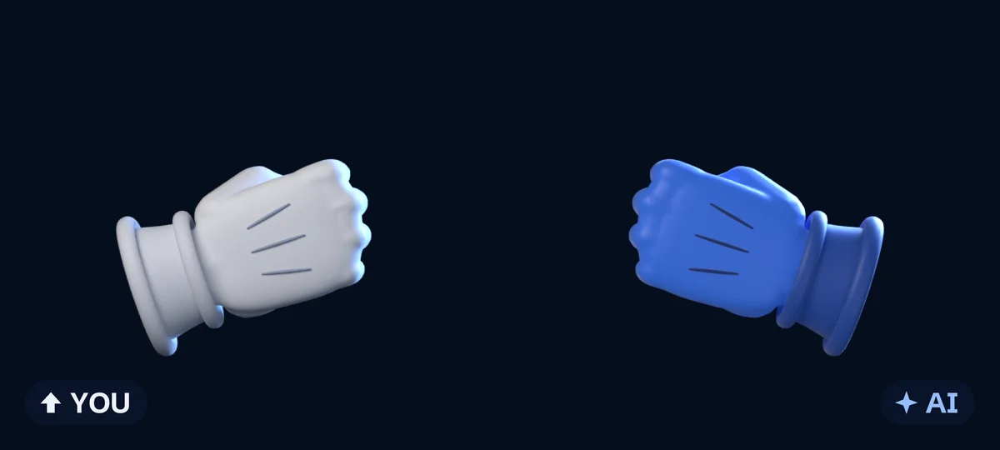

# Beat my AI

<a href="https://zimabloo.github.io/beat-my-ai/">
  <picture>
    <source media="(prefers-reduced-motion: reduce)" srcset="media/rps-loop-poster.png">
    
  </picture>
</a>

Rock-paper-scissors against a small neural network. It learns from every game people play against it, so the more of you play, the better it reads you.

[Play a game](https://zimabloo.github.io/beat-my-ai/) (ten rounds, about a minute). Sending your game needs a GitHub account.

## How it works

1. You play ten rounds on the game page. The AI picks its move before it sees yours.
2. The page turns your game into a short code: which version of the AI you played, the random seed of that game and your ten moves. The send button opens a form in this repo with the code already filled in.
3. An automatic job (GitHub Actions) replays the game from that code. The AI's moves and the score are worked out again from your moves, so nobody can send a made-up score.
4. The game is added to `data/games.jsonl`. The network is trained again from scratch on all the games, and the scoreboard on my profile is redrawn.
5. The job replies on your form with the result and closes it. The whole thing takes about a minute.

## The AI

It is small on purpose. It looks at four things: your last move, its own last move, your move before that and how the last round went. From those it estimates how likely you are to play rock, paper or scissors next, and then it usually plays whatever beats your most likely move. Sometimes it picks another one, so it can't be read too easily itself.

The network has 16 inputs, one hidden layer of 12 and 3 outputs. It is trained with PyTorch and runs in your browser as plain TypeScript. Tests check that both sides compute the same numbers.

After every training run it is measured on the newest fifth of the games, which it hasn't seen. Pure guessing gets one in three right. Two rules of thumb are measured next to it: always expecting your most common move, and expecting you to repeat your last one. The numbers are in `data/report.json`. Before anyone has played, the AI has nothing to learn from and guesses at random.

## What gets stored

Every game is one line in `data/games.jsonl`:

- the moves of both sides and the score
- how long you took before each move, and whether you used a mouse, a touch screen or the keyboard
- when it was played, the number of the form it came in and the AI version you played against
- a player number. It is made by scrambling your GitHub account number with a secret only I have, so it can't be turned back into your account
- your GitHub name, only if you ticked the box to show it on my profile

The form you send is a normal GitHub issue, so your GitHub name is visible on it either way. One person can add five games a day.

Records are only added, never changed. The statistics, the scoreboard and the AI itself can all be rebuilt from them, and every earlier version of the AI is kept in `data/brains/`.

## What is in the repo

- `web/` is the game page (TypeScript and Vite, no framework).
- `engine/` holds the rules, the AI's move choice and the replay that checks a game.
- `trainer/` trains and measures the network (Python and PyTorch) and draws the scoreboard.
- `shared/` has examples that both the engine and the trainer are tested against.
- `data/` is the games, the AI versions and the statistics.
- `art/` builds the gloves. They are made by script in Blender, with no manual modelling.
- `media/` has the finished loop, the scoreboard and the Play button my profile shows.
- `.github/` is the form and the automatic job.

## Run it yourself

The game page:

```
cd web && npm install && npm run dev
```

The tests:

```
cd engine && npm install && npm test
cd web && npm install && npm test
cd trainer && python -m venv .venv && .venv/bin/pip install -r requirements.txt && .venv/bin/python -m pytest
```

The loop needs Blender and Python with Pillow. The first step renders the 3D frames and takes about 9 minutes. The second takes seconds, so changing a label doesn't need a new render.

```
blender -b -P art/animate.py -- art
python3 art/assemble.py art media
```

The job needs one secret, `PLAYER_SALT`, which scrambles the player numbers. The game page goes online only when the repository variable `PAGES` is set to `on`.

After cloning, switch on the commit check once. It blocks a commit with the wrong author email or a `.env` file.

```
git config core.hooksPath hooks
```

<sub>Built with AI coding agents. I review and test every change myself.</sub>
